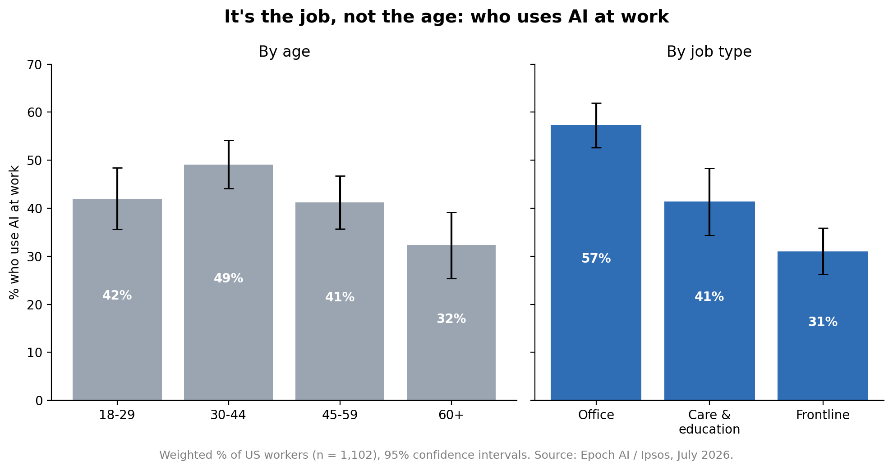

# AI-Native or Left Behind? How Young Workers Really Use AI

🚧 **Status: draft results (Nov 2026). Final polish through early Dec 2026.**

**Are young workers really "AI natives" at work? I analyzed a national survey of 1,103 employed
U.S. adults to find out. Short answer: your job and your degree matter far more than your age.**

## Key findings
1. **It's the job, not the age.** Office workers use AI at work far more than frontline workers
   (57% vs. 31%). Once degree and job type are held equal, workers aged 18–29 and 30–44 use AI
   at work at about the same rate (+0.9 percentage points). The one real age gap: workers 60+
   are about 11 points less likely to use it.
2. **Using AI doesn't mean saving time.** Among people who use AI on work tasks, about 2 in 5
   save time, 2 in 5 see no change, and **1 in 5 say it makes their work slower**, and this
   split looks about the same across age, degree, and job type.
3. **Government "AI exposure" ratings match reality.** AI use rises from 16% in jobs the Bureau
   of Labor Statistics rates as low-exposure to 56% in very-high-exposure jobs. Even comparing
   people in the same type of job, the most exposed workers are about 25 points more likely to
   use AI (a borderline but robust result).

## The question
AI capabilities are advancing faster than experts predicted, but adoption at work is uneven.
This project asks: **is the AI gap between young and older workers really about age, or is it
explained by education and job type?** It also looks at who actually saves time with AI, and
whether the jobs the U.S. Bureau of Labor Statistics rates as "highly AI-exposed" actually show
more AI use.

## Data
- **Epoch AI / Ipsos "AI at work" survey (July 2026):** 1,103 employed U.S. adults from a
  probability-based panel, with survey weights. [Source](https://epoch.ai/data/polling) (CC-BY 4.0)
- **BLS AI exposure categories (Aug 2026):** relative AI-exposure ratings (Low / Moderate / High /
  Very high) for 831 occupations. [Source](https://www.bls.gov/emp/publications/ai-exposure-categories.htm)
- The two are linked through respondents' occupation codes (852 workers could be matched).

## Findings in detail

### Q1. Is it age, or something else?
| Group | % using AI at work |
|---|---|
| Age 18–29 / 30–44 / 45–59 / 60+ | 42% / 49% / 41% / 32% |
| Office / Care & education / Frontline | 57% / 41% / 31% |

- Only **25% of workers aged 18–29 have a bachelor's degree**, vs. about 50% of those aged 30–44,
  and about half of young workers are in frontline jobs (retail, food service, trades).
  That composition, not age itself, explains why young workers look average.
- In a survey-weighted regression holding degree, job type, gender, income and race equal:
  18–29 vs. 30–44 differ by **+0.9 points**; a degree adds **~10 points**; frontline jobs are
  **~23 points** below office jobs; workers 60+ are **~11 points** lower.
- In the raw tables, young office workers looked like the heaviest users (69%), but a formal
  test found no evidence that the age pattern differs by job type (p = 0.64).

### Q2. Who actually saves time with AI?
Among the 284 workers who could compare tasks before vs. after AI:
**40% net time-savers · 41% no change · 19% net slower.**
The share of time-savers is about 40% in every age, degree, and job-type group;
the differences are small and within the margin of error.

<!-- Figure B (Q2) goes here -->

### Q3. Do "AI-exposed" jobs actually use more AI?
| BLS exposure rating | Low | Moderate | High | Very high |
|---|---|---|---|---|
| % using AI at work | 16% | 36% | 45% | 56% |

Holding job type, degree, age, and demographics equal, very-high-exposure workers are still
**~25 points** more likely to use AI than low-exposure workers (joint test p = 0.049; p = 0.042
when uncertain occupation matches are excluded). Covers the 852 workers with a specific
occupation code, not manual/trades jobs.

<!-- Figure C (Q3) goes here -->

## Methods
- **Weights and uncertainty:** all estimates use the survey weights; 95% confidence intervals use
  Kish's effective sample size. Groups under 30 people are not reported; 30–50 are flagged.
- **Validation first:** before any new analysis, I reproduced Epoch's published figures
  (within 0.1 percentage points) and matched their standard errors on the full sample.
- **Regression:** survey-weighted logistic regression (statsmodels GLM, robust standard errors),
  reported as weighted average marginal effects in percentage points. Joint Wald tests for
  multi-category effects and the age × job-type interaction.
- **Time saved:** each task is labeled faster / same / slower by comparing the time ranges people
  reported now vs. before AI; a person is a "net time-saver" if more of their tasks got faster than slower.
- **Linking to BLS:** survey occupation codes matched to BLS occupations by exact code, then by
  occupation group, then by hand using the official 2010→2018 SOC crosswalk (0 left unmatched).
  When a code covers several BLS jobs with different ratings, it gets the rating covering the most
  workers, plus a match-confidence score used in a robustness check.

## What this adds beyond Epoch's report
Epoch's published tables break results down one characteristic at a time. This project:
- **Crosses** age with degree and job type to separate their effects
- **Tests** them together in a regression, reported in percentage points
- **Builds a person-level "net time-saver" measure** from task-level answers
- **Links the survey to BLS exposure ratings** to test whether predicted exposure matches real use

## Limitations
- **Associations, not causes.** One survey at one point in time.
- **Self-reported time, in ranges.** A task that went from 4 hours to 2 stays in the same range and
  counts as "no change," so the 40% time-saver figure is likely a floor. "Slower" may include
  time spent learning the tools.
- **Small groups.** Q2 has 284 people, and some cells are small (e.g., 58 workers aged 18–29 with a
  degree), so some intervals are wide.
- **Q3 coverage.** Manual/trades workers weren't asked for a specific occupation, so Q3 covers
  852 workers mostly in office, service, and healthcare jobs. The extra exposure effect is borderline (p ≈ 0.04–0.05).
- **BLS ratings are relative rankings**, not forecasts of job loss; occupation matching involved
  some judgment (documented in `01_clean.ipynb`).
- **Approximate intervals.** The public file has no survey-design detail (strata/clusters).
- Income is household income; gender is recorded in two categories.

## Progress
- [x] Project brief and analysis plan
- [x] Data verification (`notebooks/00_verify.ipynb`)
- [x] Cleaning + validation against published figures (`01_clean.ipynb`)
- [x] Analysis Q1–Q3 (`02_analysis.ipynb`)
- [x] Main figure (`03_figures.ipynb`)
- [ ] Supporting figures and robustness checks
- [ ] Interactive "Where do you stand?" tool

## Repository structure
- `data/raw/`: original files, never edited
- `data/processed/`: cleaned data created by `01_clean.ipynb`
- `notebooks/`: 00_verify → 01_clean → 02_analysis → 03_figures
- `src/helpers.py`: reusable functions (weighted percentages, confidence intervals, group tables)
- `figures/`: saved charts

## How to run
1. Python 3.14 with: `pip install pandas numpy statsmodels matplotlib openpyxl`
2. Run the notebooks in order (00 → 03) from the `notebooks/` folder.

## Transparency
Utilized AI as a collaborator for brainstorming, code drafts and syntax explanations. 
I chose the question, made the design and analysis decisions, and verified every result.
